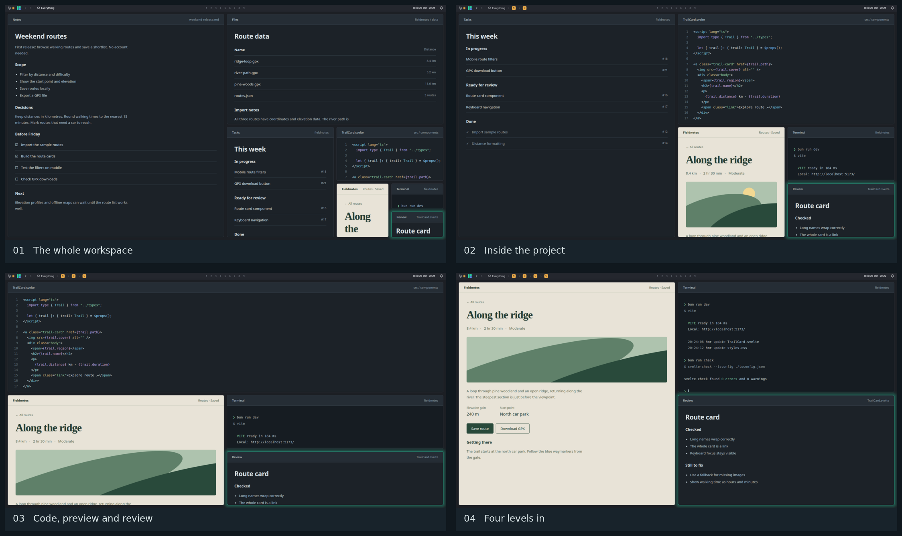

# Tileception

**Tile it. Nest it. Zoom it.**

Tileception is a Wayland compositor for Linux where windows live in a nested tree
of tiles. Keep related windows together, zoom in to focus on one window or a
group, and zoom back out to see the bigger picture.

Written in Rust on [Smithay](https://smithay.github.io/), with Xwayland support
for X11 applications.



*One workspace, four zoom levels. Captured in a nested session with fictional demo content.*

<a id="installing-as-a-session"></a>

## Install and try

Tileception is in alpha. Expect changes between releases. Currently, only one
monitor is supported; additional monitors stay inactive in a Tileception session.

Packages are available for **Debian 13 / sid** and **Ubuntu 24.04 / 26.04**, on
**amd64** and **arm64**, including derivatives based on those releases, such as
**Linux Mint**.

```sh
curl -fsSL https://tileception.space/install | sh
```

The [installer](website/public/install) adds the signed Tileception APT repository
and installs the package, using sudo when needed. Updates arrive through your
normal system updates.

<a id="install-options"></a>
<details>
<summary>Unattended or custom install</summary>

The installer asks how to set Tileception up before it changes anything. To
answer up front, pass options after `sh -s --`:

```sh
# No questions, recommended setup
curl -fsSL https://tileception.space/install | sh -s -- --non-interactive --preset recommended

# Minimal: no bar, notifications or Doctor
curl -fsSL https://tileception.space/install | sh -s -- --non-interactive --preset minimal

# Recommended, but your own programs in place of Tileception's launcher and bar
curl -fsSL https://tileception.space/install | sh -s -- --non-interactive --preset recommended --launcher fuzzel --bar waybar

# Also make Tileception's greeter the login screen
curl -fsSL https://tileception.space/install | sh -s -- --greeter tileception
```

Presets are `recommended`, `minimal`, `customize` and `keep`. `--bar`,
`--launcher`, `--notifications`, `--power-menu` and `--lock` take `builtin`,
`none` or a command; `--media` and `--doctor` take `builtin` or `none`. Run `tileception-setup --help`
after installing for every option, or run `tileception-setup` again at any time
to change your choices.

</details>

See the [installation guide](docs/installation.md) for details, updates and
removal instructions.

To try Tileception in a window inside your current Wayland or X11 desktop, run:

```sh
tileception --nested
```

To use it as your desktop session, log out and select **Tileception** on your
login screen. Press **Super** (usually the Windows key) to open the launcher, or
press **Super+T** to open a terminal. See [default shortcuts](#default-shortcuts)
for more controls.

## How it works

Opening a window splits the focused tile along its longer side. Splits can nest
inside other splits, so a browser and its notes can sit together beside a group
of development tools. Drag the gaps to adjust how much space each part gets.

Zoom into a group to fill the screen with its windows, or into a single window
to focus on it. Zoom back out to see the surrounding layout. Saved views let
you return to particular parts of the tree without rearranging your windows.

Drag a window to a tile's edge to place it beside that tile, or to its centre to
combine them into tabs. Windows can also float above the tiled layout.

The desktop includes a launcher, top bar with a system tray, notifications, lock
screen, power menu, and volume and brightness controls. You can disable built-in
components or use external tools such as Waybar, fuzzel and swaylock through the
[configuration](#configuration).

Doctor, an optional panel opened with **Super+/**, lets a coding agent of your
choice answer questions about your setup and change it for you.

Touchpad gestures, touchscreen input and fractional display scaling are supported
too.

<a id="default-shortcuts"></a>

## Getting around

**Super** is usually the Windows key. In a nested session, use **Alt** in its
place so your current desktop can keep its Super shortcuts.

| Shortcut          | Action                                               |
|-------------------|------------------------------------------------------|
| Super             | Open the launcher                                    |
| Super+T           | Open a terminal                                      |
| Super+Arrow keys  | Focus a neighbouring window or group                 |
| Super+= / Super+- | Zoom one level in / out                              |
| Super+O           | Show the overview                                    |
| Super+F           | Make the app fullscreen, or restore it               |
| Super+M           | Fill the screen with the focused window, or restore  |
| Super+J           | Switch the current split between rows and columns    |
| Super+V           | Switch the focused window between floating and tiled |
| Super+C           | Close the focused window                             |
| Super+L           | Lock the screen                                      |
| Super+X           | Open the power menu                                  |
| Super+/           | Open Doctor                                          |

Hold **Super** and scroll to zoom in towards the pointer or back out. Hold
**Alt** and drag with the left mouse button to move a window, or with the right
button to resize it. Drag a gap between tiles to resize their split.

Save the current view with **Super+Shift+1** through **9**, then return to it with
**Super+1** through **9**.

See the [usage guide](docs/usage.md) for selections, tabs, floating windows and
gestures.
The [default configuration](crates/tileception/src/default-config.toml) lists
the complete bindings, including tabs, window moves, screenshots and gestures.

## Configuration

Tileception creates `~/.config/tileception/config.toml` on first run. If you set
`XDG_CONFIG_HOME`, it uses `$XDG_CONFIG_HOME/tileception/config.toml` instead.
Changes reload automatically when you save the file.

For example, edit these values in their existing sections to reduce the gaps,
change the accent colour and add another terminal shortcut:

```toml
[general]
gap = 8

[theme]
accent = "#e5b567"

[binds]
"Super+Return" = "terminal"
```

Custom bindings add to or override the defaults. Set a binding to `"none"` to
disable it.

The [configuration guide](docs/configuration.md) has examples for shortcuts,
appearance and scaling. The
[commented default configuration](crates/tileception/src/default-config.toml)
covers themes, wallpaper, display scaling, input, window rules, autostart and
replacing built-in desktop components with external tools.

You can also control a running session from scripts with `tileception msg`.
Run `tileception msg --help` for the available commands; bindings use the same
command names.

## Help and development

Found a problem? [Open an issue](https://github.com/robinvandernoord/tileception/issues);
[Report a problem](docs/troubleshooting.md#report-a-problem) lists what to include.

Session logs are in `~/.local/state/tileception/tileception.log`, or under
`$XDG_STATE_HOME/tileception/` if set. Nested sessions print logs to the terminal
you started them from. Check logs for personal information before sharing them.

- [Documentation](docs/index.md): all user guides, including Doctor and the
  login screen.
- [Troubleshooting](docs/troubleshooting.md): startup problems, config errors
  and logs.
- [Development](docs/development.md): local and remote builds with cargo-plane,
  dependencies, tests and linting.
- [Roadmap and architecture](PLAN.md): current direction and how the crates fit
  together.
- [Changelog](CHANGELOG.md): changes between releases.

Tileception is MIT licensed. Its nested tiling model is inspired by TrellisWM
for macOS.
